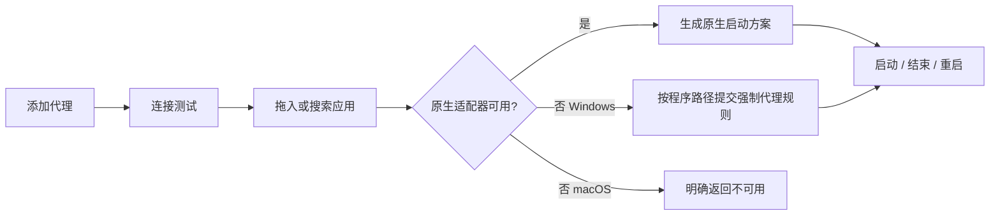
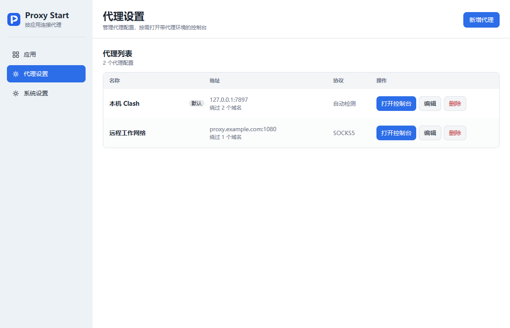
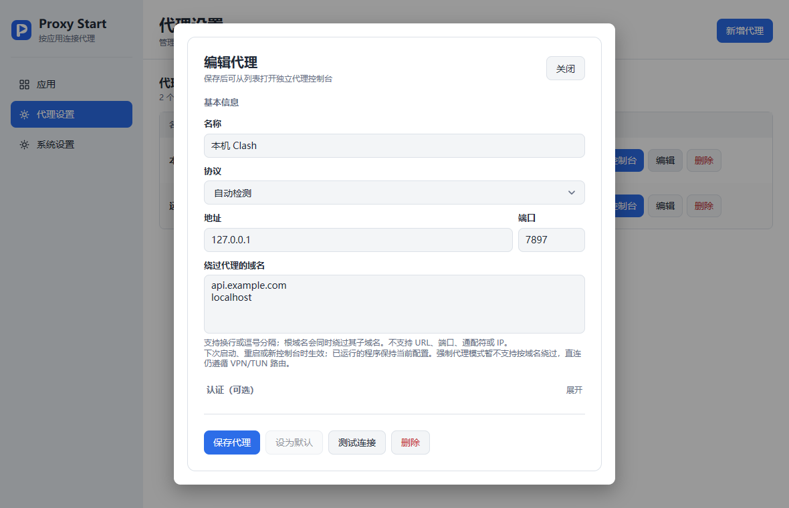
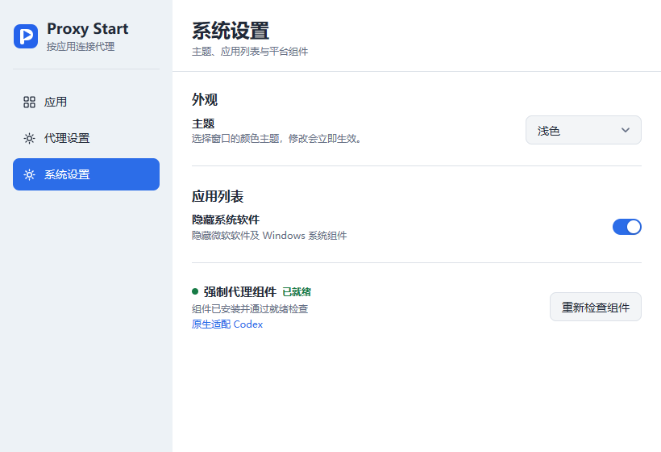
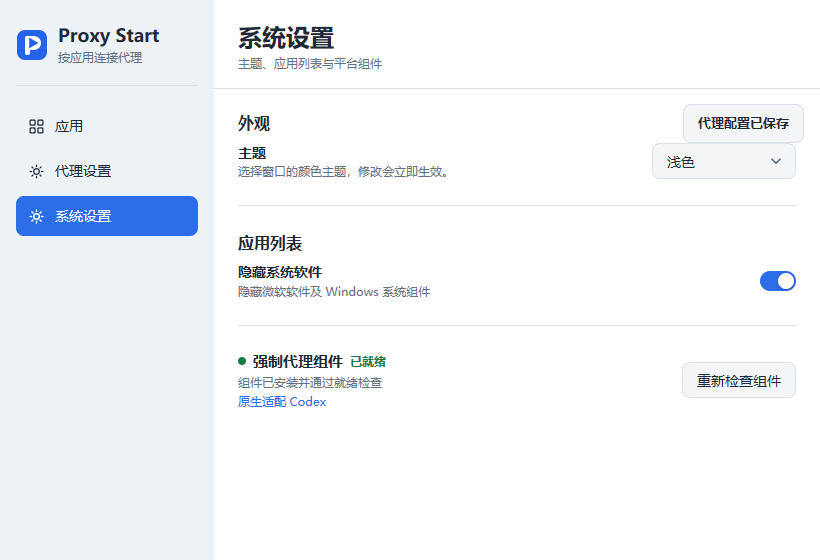

<h1 align="center"> Proxy Start</h1>

<p align="center"><strong>基于 Go 与 <a href="https://github.com/egoist/mygo">MyGO</a> 构建的原生代理启动器。</strong></p>

<p align="center">
  <a href="https://github.com/javatoai/proxy-start/releases"><strong>下载 Release</strong></a> &nbsp;·&nbsp;
  <a href="#快速开始">快速开始</a> &nbsp;·&nbsp;
  <a href="#支持范围">支持范围</a> &nbsp;·&nbsp;
  <a href="#文档">文档</a>
</p>

Proxy Start 面向已经拥有本机或远程代理的桌面用户：保存一个代理配置，把程序拖入启动列表，再选择启动、结束或重启。界面使用 MyGO 原生控件，不依赖 WebView、Electron 或 JVM。当前目标版本为 **0.1.11**，包含代理域名绕过规则和新的 SVG 品牌图标；Windows x64 是首版完整交付平台，macOS 提供可运行源码和交叉编译包，但仍需 Mac 实机验收。

> 代理已应用只表示启动参数或规则已经提交。实际网络连接需要单独验证，不能因为程序成功启动就推断流量已经经过代理。

## 功能

- **代理配置**：管理 HTTP、SOCKS5 或自动检测代理，支持默认代理、程序单独指定、可选认证和按域名绕过。
- **应用启动列表**：拖入 `.exe`、快捷方式或 macOS `.app`，也可以从已安装应用中搜索并添加；每项支持启动、结束和重启。
- **原生与强制代理策略**：首期原生适配 Codex；Windows 对未适配或不满足原生能力的已添加程序按路径使用 ProxiFyre 强制代理。
- **代理控制台**：从代理列表打开独立 PowerShell（Windows）或 Terminal（macOS），为新 shell 及其子进程注入代理环境变量。
- **系统设置**：单独管理主题、隐藏系统软件和 Windows 强制代理组件。
- **托盘运行**：关闭窗口后收进托盘；完整退出会释放代理组件和桥接，但保留已经启动的目标程序。

“打开代理控制台”会为新 shell 注入 `HTTP_PROXY`、`HTTPS_PROXY`、`ALL_PROXY` 以及对应的小写变量，不改变系统全局环境。只有会读取这些变量的工具才会跟随代理；忽略环境变量、使用自己的配置或显式代理参数的工具不会自动跟随。控制台打开成功也不等同于实际请求成功。

代理编辑器中的“绕过代理的域名”支持换行或逗号分隔。每条规则是一个 ASCII 主机名或域名（包括 Punycode），例如 `example.com` 同时匹配该域名和它的子域名；规则会自动转为小写并去重。首版不接受 URL、端口、通配符或 IP/CIDR。原生 Codex 启动会生成 Chromium 的 `--proxy-bypass-list` 并设置 `NO_PROXY` / `no_proxy`；代理控制台会用规则覆盖子 shell 继承的 bypass，规则为空时清除继承值。规则只影响 Proxy Start 选择的代理，不改写 VPN、TUN 或系统路由，在下一次启动、重启或打开新控制台时生效，已经运行的进程保持原配置。带绕过规则的应用若只能使用 Windows 强制代理，会明确提示当前强制代理模式不支持按域名绕过，并保留原进程。

## 界面与工作流

侧栏固定为“应用”“代理设置”“系统设置”。代理设置使用列表展示名称、地址、协议和默认状态，每行提供打开控制台、编辑和删除；新增与编辑使用模态表单。操作结果显示为右上角悬浮提示：成功提示自动消失，错误提示保留到手动关闭。



## 界面导览

<table>
  <tr>
    <td width="50%" valign="top"><strong>代理列表</strong><br>
      查看代理地址、协议、默认状态，并直接打开控制台、编辑或删除。<br><br>
      <a href="docs/assets/readme-proxy-list.png"></a></td>
    <td width="50%" valign="top"><strong>代理编辑</strong><br>
      新增或编辑使用模态表单，支持认证和连接测试。<br><br>
      <a href="docs/assets/readme-proxy-editor.png"></a></td>
  </tr>
  <tr>
    <td valign="top"><strong>系统设置</strong><br>
      主题、系统软件过滤和强制代理组件各自独立管理。<br><br>
      <a href="docs/assets/readme-system-settings.png"></a></td>
    <td valign="top"><strong>操作反馈</strong><br>
      成功、进行中和错误状态显示在右上角悬浮提示中。<br><br>
      <a href="docs/assets/readme-toast.png"></a></td>
  </tr>
</table>

<sub>图片来自本地 MyGO 内存渲染的测试数据，仅用于展示布局；地址使用示例值，不代表用户配置或真实网络结果。</sub>

## 快速开始

### 下载

发布包会放在 [GitHub Releases](https://github.com/javatoai/proxy-start/releases)。Windows 下载 `ProxyStart-windows-amd64.zip`，完整解压后运行 `proxy-start.exe`，也可以执行包内 `scripts/install.cmd` 做每用户安装。macOS 下载对应架构的 `ProxyStart-macos-arm64.zip` 或 `ProxyStart-macos-amd64.zip`，解压后将 `Proxy Start.app` 放入“应用程序”。

当前 macOS 包未完成 Developer ID 签名、公证和 Mac 实机验收；首次打开可能需要在“系统设置 → 隐私与安全性”中允许。Linux、Windows ARM 和其他未列出的架构不提供客户端包。

### 配置并启动

1. 打开“代理设置”，新增代理。可填写 `127.0.0.1:7897`，协议选择自动检测，或手动选择 HTTP / SOCKS5；需要直连的域名可在“绕过代理的域名”中按行或逗号填写，例如 `localhost, example.com`。Clash 等本地代理需要自行保持运行。
2. 进入“应用”，拖入目标程序或从“添加已安装应用”中搜索。系统软件默认隐藏，已加入列表的应用显示“已添加”。
3. 为应用选择默认代理或单独指定的代理，然后点击启动。已有实例需要重新应用设置时使用“重启”。
4. 需要临时在 shell 中验证代理时，在“代理设置”列表点击“打开控制台”。Windows 新 PowerShell 中请使用 `curl.exe`（Windows PowerShell 的 `curl` 是别名），例如：

   ```powershell
   curl.exe -I https://example.com
   ```

   该命令只能验证该 shell 中的请求；要证明某个目标软件的真实流量经过代理，还需要针对该软件做集成验收。

## 支持范围

| 平台 | 原生代理 | 按程序强制代理 | 当前状态 |
| --- | --- | --- | --- |
| Windows x64 | Codex，支持无认证 HTTP 和域名绕过 | ProxiFyre + Windows Packet Filter；只为已选择程序生成路径规则，暂不支持域名绕过 | 首版完整客户端路线，需在目标环境验收真实流量 |
| macOS arm64 / amd64 | Codex，支持无认证 HTTP 和域名绕过；使用 `.app` 身份、启动参数和环境变量 | 不支持 | 有源码和交叉编译包，尚无 Mac 实机 GUI、Codex、控制台、Keychain、签名或公证验收 |
| Linux | 不提供 | 不提供 | 暂不支持 |

macOS 的代理控制台会用私有临时脚本打开 Terminal，支持代理环境变量注入；这项实现和 Keychain 代码已经在仓库中，但 Windows 交叉编译或 CI 通过不能代替 Mac 实机运行。macOS 对不支持的协议、认证或强制代理请求会明确返回不可用，不会悄悄无代理启动。

Windows 强制代理首次使用需要在“系统设置”中准备组件并接受管理员向导。组件安装、服务状态和目标程序流量分别验证；安装器启动不代表驱动已经可用。关闭客户端不会终止已启动的目标程序；强制代理组件停止后，这些程序可能直连或连接失败。

## 数据与安全边界

- Windows 普通设置：`%APPDATA%\Proxy Start\settings.json`；日志：`%LOCALAPPDATA%\Proxy Start\logs\proxy-start.log`。
- macOS 普通设置：`~/Library/Application Support/Proxy Start/settings.json`；日志：`~/Library/Caches/Proxy Start/logs/proxy-start.log`。
- 密码不写入 JSON：Windows 使用当前用户凭据管理器，macOS 使用当前用户 Keychain。备份普通设置不会导出密码。
- GUI 默认不要求管理员权限，不修改系统代理、Clash 配置、默认路由或全局 TUN。需要 Windows 强制代理时，仅按需使用受限管理员辅助进程。
- HTTP 上游通过 CONNECT 转发 TCP，桥接拒绝 UDP；SOCKS5 UDP 是否可用取决于上游代理。系统 DNS、受保护进程和特殊网络栈行为不属于首版完整覆盖保证。

## 开发与发布

项目使用 Go 1.27.x、MyGO v0.5.5 和显式依赖注入。依赖方向为“界面 → 应用用例 → 领域与接口”，Windows、macOS、存储、凭据、进程及强制代理均通过平台适配器接入。没有全局服务定位器；适配器只识别程序和生成启动方案，实际启动由平台进程控制器执行。

本地构建和预览：

```powershell
.\scripts\build.ps1 -GUI
.\scripts\run.ps1
.\scripts\pack.ps1 -OutputDir dist\release-0.1.11 -Proxy http://127.0.0.1:7897
.\scripts\pack-macos.ps1 -OutputDir dist\release-0.1.11-macos -SkipTests
```

GitHub Actions 的发布约定与 Silverwing 类似：普通分支和 Pull Request 运行测试与平台构建；推送严格匹配产品版本的 `v0.1.11` 标签时，分别构建 Windows x64 与 macOS arm64 / amd64，汇总经过校验的包，再由发布任务创建 GitHub Release。CI 的跨平台编译、单元测试和 ZIP 检查不等于 Mac 实机 GUI、Codex 网络或强制代理验收；本地打包也不会安装驱动或发布 Release。具体命令和流程见 [发布说明](docs/RELEASE.md)。

## 文档

| 文档 | 内容 |
| --- | --- |
| [构建与运行](docs/BUILD.md) | 工具链、预览、代理控制台诊断入口和 Windows 打包 |
| [发布说明](docs/RELEASE.md) | 版本、标签、CI 构建和发布检查 |
| [架构与适配器扩展](docs/ARCHITECTURE.md) | 分层边界、启动策略、ConsoleLauncher 与新适配器示例 |
| [macOS 说明](docs/MACOS.md) | `.app` 结构、交叉编译、Keychain、签名和实机验收边界 |
| [验证记录](docs/VERIFICATION.md) | 当前已执行的测试与仍需系统验收的项目 |
| [控制台真实请求验证](docs/CONSOLE-VERIFICATION.md) | HTTP / SOCKS5 HTTPS 请求、CONNECT 记录和不可达代理对照 |
| [平台路线](docs/PLATFORM-ROADMAP.md) | macOS 强制代理后续方向和 Linux 范围 |
| [第三方许可](LICENSE-THIRD-PARTY.md) | 依赖和随包组件的许可说明 |

## 开源协议

当前仓库未声明项目本身的开源许可证；请以仓库发布页和后续正式 LICENSE 文件为准。第三方组件仍保留其各自的许可证和版权声明，见 [第三方许可说明](LICENSE-THIRD-PARTY.md)。
